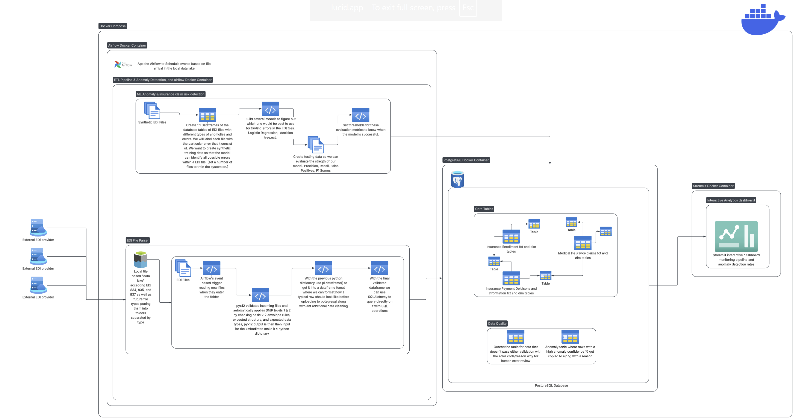

# UMSI-x-Imetris-Corporation-Capstone
This Data Engineering, Machine Learning and Analytics project focuses on transforming complex healthcare EDI (electronic data interchange) transactions (837 claims, 835 remittances, 834 enrollments) into structured, analyzable data and building predictive models to identify claim rejections and enrollment anomalies. 

## Current run steps all with windows command prompt:

### Current Architecture Diagram:
*data modeling is tentative, diagram shows high level example*



### Prerequisites:
- project requires python 3.14+ to run 

- Download Docker here: https://www.docker.com/products/docker-desktop/ docker allows for us to package airflow and Postgresql together and run seamlessly on each of our laptops/development devices locally so you won't need to download postgresql or apache airflow locally. The database and apache airflow will only be accessible when the docker containers are running. In settings under resources make sure it says: "You are using the WSL 2 backend, so resource limits are managed by Windows."

- Download WSL2 Extension on VS code: https://marketplace.visualstudio.com/items?itemName=ms-vscode-remote.remote-wsl and run  ```wsl --install``` from the command line

- Download uv with ```pip install uv```

- using the .env.example follow the directions within file to create your own .env

### Project Setup Commands to run:
*commands below must run from project root where docker-compose.yaml is*

- create the venv and sync dependencies/libraries with ```uv sync --locked```

- Run ```uv run setup_landing_folders.py``` to setup the folders that edi file data will land in.

- Run ```docker compose build``` to build the docker images that airflow & our code along with the postgres database will run on

### When developing
- Run ```docker compose up -d``` to run containers for the first time in the background, it won't rebuild images with any current code changes

- Run ```docker compose up --build -d``` to rebuild and run containers whenever you have locally made or have done a git pull-request, changes inside src, changing dependences, etc... (takes noticeably longer than )

- Run ```docker compose stop``` to stop containers from running temporarily

- Run ```docker compose start``` to restart containers that were recently stopped

### accessing postgres
*docker container must be running*
    I reccomend this extension for accessing the database: https://marketplace.visualstudio.com/items?itemName=ms-ossdata.vscode-pgsql 

    server name: localhost
    username: same as .env
    password: same as .env
    databse name: healthcare_edi
    under advanced:
        port: 5433

### accessing airflow
*docker container must be running*
    Press ctrl+shift+P and select Browser: Open Integrated Browser
    http://localhost:8080/ enter this into the search bar (You could also just ctrl+click that link)
    username: airflow
    password: airflow